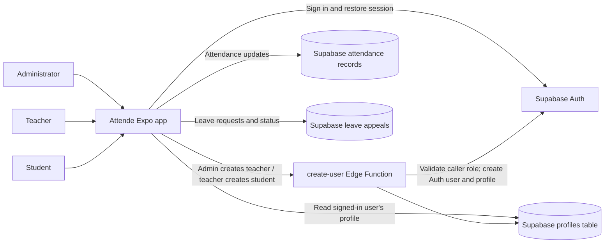

# Attende - Project and Report Handoff

This document gives a report writer the verified project context for Attende. It describes the repository as it exists now and presents the project in a report-friendly structure. The key project statement is simple: the application is built around Supabase for authentication, user profiles, role-based account provisioning, attendance records, leave requests, and related data storage.

> Project identity: This repository is Attende, a school attendance app built with Expo and React Native. It is not a general-purpose meeting app, and the README should be adapted to the school-management workflow used by the application.

## 1. Project Summary

Attende is a mobile-first attendance-management application for school administrators, teachers, and students. It replaces parts of the paper attendance process with account-based access and digital records managed through Supabase.

### Aim

To provide a simple school attendance system where administrators, teachers, and students can sign in securely, manage user accounts, record attendance, and handle leave requests through a single application connected to Supabase.

### Problem Statement

Paper-based attendance can be slow to record and difficult to review. Students may not have a convenient way to see their own attendance history or submit leave requests. Attende addresses this by using Supabase as the central backend for authentication, profiles, attendance records, and leave appeals.

### Objectives

- Provide email-and-password sign-in through Supabase Auth.
- Route each user based on the assigned role in the `profiles` table.
- Allow administrators to create teacher accounts.
- Allow teachers to create student accounts and manage class information.
- Allow teachers to mark students present, absent, or on leave.
- Allow students to view their attendance and submit leave appeals.
- Allow administrators and teachers to review and decide on leave appeals.
- Keep all core application data connected to Supabase rather than local-only storage.

### Differentiation and Positioning

Attende is positioned as a school attendance workflow application rather than a general collaboration or event app.

- Role-based onboarding: account creation follows the school hierarchy, where administrators create teachers and teachers create students.
- Student-focused attendance view: students view their attendance history through a role-based dashboard and can see their own attendance status updates.
- Attendance and leave in one flow: leave requests are linked to the same user and attendance model and can be reviewed by staff.
- Cross-platform prototype: Expo and React Native provide a shared interface for web and mobile targets while Supabase handles the backend.

### Intended Users

- Administrator: creates teacher accounts, reviews leave appeals, and manages the school account structure.
- Teacher: creates student accounts, marks daily attendance, and reviews leave requests.
- Student: views attendance, submits leave appeals, and accesses their own record.

## 2. Current Features and Workflow

### Sign-In

1. The user enters an email address and password on the sign-in screen.
2. Supabase Auth verifies the credentials.
3. The app reads the matching row in `public.profiles` using the Auth user's UUID.
4. The `role` in that profile determines whether the app opens Admin Home, Teacher Home, or Student Home.
5. The Supabase session is restored on app startup.

### Account Creation

1. The first administrator account is created manually in the Supabase dashboard with a matching `profiles` record.
2. An administrator enters a teacher's name, subject, email, and temporary password in Add Teacher.
3. A teacher enters a student's name, class, section, roll number, email, and temporary password in Add Student.
4. Both flows call the `create-user` Supabase Edge Function.
5. The function validates the caller's token and checks the caller's role before allowing account creation.
6. The server-side function creates the Auth user and inserts or updates the corresponding profile record in Supabase.
7. All user-account information is stored in Supabase and is accessed through the app.

### Attendance

1. A teacher opens Mark Attendance. The app loads the local student list and today's records.
2. Tapping a student's row toggles between Present and Absent. A student marked as on leave requires confirmation before changing the status.
3. Saving writes attendance to AsyncStorage immediately and syncs each student/date record to Supabase. Failed uploads remain queued locally and retry at the next sign-in.
4. A teacher creates a server-backed QR session valid for up to two hours. The `sync-data` Edge Function validates each student's check-in and syncs it to the daily attendance record.
5. A student sees a year-style heatmap on Student Home. The grid uses only the signed-in student's ID: green means Present, red means Absent, blue means Leave, and dark means Unmarked.

### Leave Appeals

1. A student enters a reason and submits an appeal.
2. The appeal is stored locally and submitted to Supabase with a Pending status; failed submissions remain queued for retry.
3. An administrator or the student's assigned teacher can approve or reject it from Leave Appeals.
4. Approving an appeal also marks that student as on leave for the current date in local and cloud attendance.

## 3. Technology and Architecture

### Implemented Technology

| Area                               | Technology                                          | Use in Attende                                       |
| ---------------------------------- | --------------------------------------------------- | ---------------------------------------------------- |
| App                                | React Native 0.81, React 19                         | Shared mobile and web UI                             |
| Framework/tooling                  | Expo SDK 58                                         | Development server, platform builds, and web export  |
| Navigation                         | React Navigation native stack                       | Welcome and role-based app screens                   |
| Authentication                     | Supabase Auth                                       | Email/password sign-in and persisted sessions        |
| User profiles/account provisioning | Supabase Postgres and Edge Function                 | Profile lookup and role-checked account creation     |
| Student roster and attendance      | Supabase Postgres                                   | Teacher-linked student roster and daily attendance  |
| Local application data             | AsyncStorage                                        | Offline cache and pending attendance/leave writes    |
| QR attendance                      | Expo Camera, Supabase Edge Function, `react-native-qrcode-svg` | Scan and validate expiring cloud attendance sessions |
| Web support                        | React Native Web                                    | Browser preview and web export                       |
| Android build service              | EAS Build                                           | Cloud Android builds                                 |

The project is designed around Supabase as the main backend and storage layer. Local storage is not the primary source of truth for attendance, leave, or user records.

### Architecture Overview

### Supabase Data Model

The app is centered on Supabase database tables. The main entities are as follows.

#### `profiles`

| Field | Meaning |
| --- | --- |
| `id` | UUID matching the user's `auth.users.id` |
| `email` | User sign-in email |
| `name` | Display name |
| `role` | `admin`, `teacher`, or `student` |
| `class` | Student class |
| `section` | Student section |
| `roll_no` | Student roll number |
| `subject` | Teacher subject |
| `teacher_id` | Teacher reference for a student |

#### `attendance_records`

Stores attendance status for a student for a day or attendance session.

| Field | Meaning |
| --- | --- |
| `id` | Primary key |
| `student_id` | Linked student |
| `teacher_id` | Teacher who recorded the status |
| `session_id` | Linked attendance session |
| `status` | `present`, `absent`, `leave`, `unmarked` |
| `date` | Attendance date |
| `check_in_at` | Timestamp of the attendance update |
| `source` | Manual or QR-based check-in |

#### `leave_appeals`

Stores student leave requests and staff decisions.

| Field | Meaning |
| --- | --- |
| `id` | Primary key |
| `student_id` | Student submitting the leave request |
| `reason` | Leave reason |
| `status` | `pending`, `approved`, `rejected` |
| `created_at` | Request timestamp |
| `reviewed_at` | Decision timestamp |
| `reviewed_by` | Teacher/admin who processed it |

#### `class_sessions`

Tracks teacher-created class sessions and QR attendance events.

| Field | Meaning |
| --- | --- |
| `id` | Primary key |
| `teacher_id` | Teacher creating the session |
| `class` | Class name |
| `section` | Section |
| `session_date` | Date of the class session |
| `start_time` | Session start |
| `end_time` | Session end |
| `expires_at` | Session expiry |
| `status` | Active or expired |
| `qr_token` | QR session token |

### Access Control

- The sign-in flow obtains the role from `profiles`; it is not selected by the user.
- RLS policies should be enforced at the database level so users can only access appropriate records.
- The Edge Function checks the authenticated caller's role before creating an account.
- The Supabase service-role key must remain server-side in the Edge Function environment and must not be placed in the client app.
- Attendance, leave, and related records are stored in Supabase and are intended to be protected by RLS and role-specific policies.

## 4. Report Requirements and Design Notes

### Functional Requirements

1. Sign in with email and password.
2. Load a profile and open a screen based on the user's role.
3. Allow administrators to create teacher accounts.
4. Allow teachers to create student accounts.
5. Let teachers toggle and save student attendance for a date.
6. Let a student view their attendance history.
7. Let a student submit a leave appeal.
8. Let an administrator or teacher approve or reject appeals.

### Non-Functional Requirements

These are appropriate requirements to discuss and evaluate; not all are formally benchmarked.

- Security: validate roles server-side for account creation and enforce least-privilege database policies.
- Privacy: students should only access their own attendance and profile data.
- Usability: provide clear role-specific screens and status labels.
- Portability: support Expo development targets, including web and Android.
- Reliability: handle invalid credentials, missing configuration, empty lists, and network failures with clear feedback.

### Software and Hardware

- Node.js and npm for dependency installation and Expo commands.
- Expo developer tooling and a browser for web testing.
- A Supabase project for authentication, database, and Edge Function hosting.
- A computer capable of running Node.js; an Android device or emulator is useful for testing.

## 5. Screens and Implementation Map

| Screen          | Purpose                                                                      |
| --------------- | ---------------------------------------------------------------------------- |
| Welcome         | Email/password sign-in and role-based routing                                |
| Admin Home      | Add teachers, view synced teacher/student lists, review appeals               |
| Teacher Home    | View synced assigned students, add students, mark attendance, review appeals  |
| Student Home    | Show the student's own profile and attendance heatmap; open leave appeal     |
| Add Teacher     | Collect teacher profile and credentials, then call account-creation function |
| Add Student     | Collect student details and credentials, then call account-creation function |
| Mark Attendance | Toggle present/absent and save the day's local attendance                    |
| Appeal Leave    | Submit and view the current student's leave requests                         |
| Leave List      | Review and approve/reject authorized leave requests                          |

Navigation is configured in `App.js`; app state and data access are connected to Supabase-backed services and configuration files, including the Supabase client and Edge Function integration points.

## 6. Testing and Experimental Analysis

There is no automated test suite currently defined in the repository. Tests and performance numbers should only be reported if they are actually run and recorded.

### Suggested Manual Test Cases

| Test | Expected result |
| --- | --- |
| Sign in with valid admin credentials | Admin Home opens |
| Sign in with teacher or student account | Correct role screen opens |
| Sign in with invalid credentials | Readable error display; no role screen opens |
| Admin creates teacher | Auth account and profile are created in Supabase |
| Teacher creates student | Auth account and profile are created with proper teacher link |
| Non-admin tries to create a teacher | Edge Function rejects the request |
| Teacher records attendance | Supabase attendance record updates correctly |
| Student views attendance | Only their own attendance data is shown |
| Student submits leave appeal | Appeal is stored with `pending` status |
| Teacher/admin decides on appeal | Appeal status updates in Supabase |
| QR scan with valid or invalid session | Valid scans update attendance; invalid scans are rejected |

### Experimental Analysis Guidance

No measured comparison or performance results are included with the source. A report can propose a small usability study or compare the time needed to record attendance manually versus through the app, but such results must be clearly labeled as proposed or unverified.

## 7. Limitations and Challenges

- Leave appeals, attendance, and directories sync through Supabase, with AsyncStorage used as a local cache and offline queue.
- Apply all three migrations in `supabase/migrations/` and deploy `supabase/functions/sync-data` before using the cloud-backed features. Row-level security limits leave reads to students, their assigned teachers, and administrators; only teachers/admins can review appeals.
- The account-creation function and Supabase project must be configured and deployed before those forms can create working accounts.
- The first administrator must be provisioned manually in Supabase.
- The current app is a prototype; school-wide data synchronization, database policies for attendance/leave, and production operations are not complete.
- No face-recognition check-in is implemented.
- No automated test suite or measured performance study is currently provided.

## 8. Future Scope

Possible next features and improvements:

1. **Production operations:** add automated sync conflict tests, monitoring, and recovery for offline attendance and leave writes.
2. **Optional face-based attendance:** only consider after a privacy, consent, accessibility, and legal review. Provide a non-biometric option such as QR/manual check-in; avoid retaining raw face images unless strictly necessary and approved.
3. **Reports and exports:** add class summaries, date-range reports, and CSV/PDF export.
4. **Offline-first sync:** queue teacher attendance updates offline and sync safely when online.
5. **Notifications and account recovery:** notify users of leave decisions and support password reset.
6. **Class management:** manage classes/sections and assign teachers to groups.

### Production Hardening (Future Work)

Move all critical application records and validation logic into Supabase-backed policies and server-side checks. The backend should verify signed, expiring tokens, confirm student-to-class membership, and enforce one attendance record per session.

## 9. Guidance for the Report Writer

- Use Attende as the project name and treat Supabase as the primary system architecture.
- The app is centered on authentication, profiles, attendance, and leave management; these should be the main report themes.
- For architecture and ER diagrams, show Supabase Auth, profiles, attendance tables, and leave tables as the core backend model.
- For testing and experimental analysis, run tests and collect measurements. Clearly label any proposed tests that have not yet been performed.
- Treat the current QR and attendance workflow as implemented prototype functionality, with future hardening still required.
- Ensure the project report reflects that the system is not local-only; the main business data is connected to Supabase.
