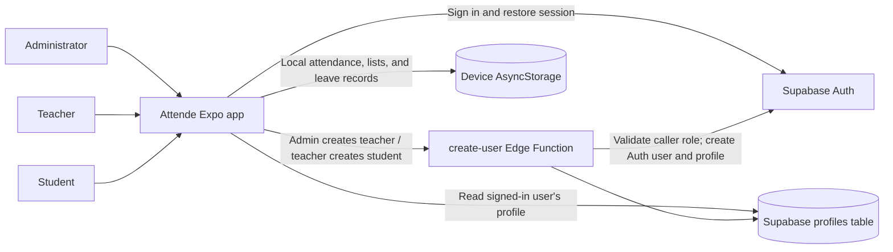
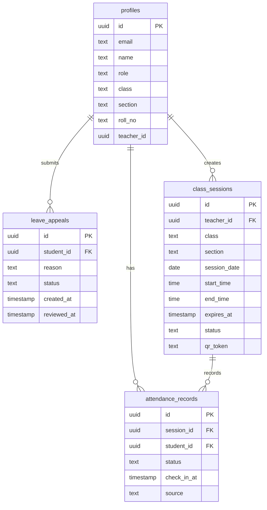

# Attende - Project and Report Handoff

This document gives a report writer the verified project context for Attende. It describes the repository as it exists now; separate **Implemented**, **Limitation**, and **Future Work** notes so project claims stay accurate and traceable to code.

> **Project identity:** This repository is Attende, a school attendance app built with Expo and React Native. It is not a general-purpose meeting app, and the README should be adapted to the school-attendance domain rather than copied from a meeting-product template.

## 1. Project Summary

Attende is a mobile-oriented attendance-management application for school administrators, teachers, and students. It aims to replace parts of a paper attendance register with account-based access, teacher-controlled attendance recording, and student-facing attendance views.

### Aim

To provide a simple application for managing school attendance and leave requests, with separate workflows for administrators, teachers, and students.

### Problem Statement

Paper-based attendance can take time to record and review, and students may not have a convenient way to check their attendance or submit a leave request. Attende prototypes a digital workflow for attendance tracking and leave appeals in a school setting.

### Objectives

- Provide email-and-password sign-in.
- Route each signed-in user according to their assigned account role.
- Allow administrators to create teacher accounts.
- Allow teachers to create student accounts and enter class details.
- Allow teachers to mark students present or absent.
- Let a student view their own attendance and submit a leave appeal.
- Let administrators and teachers review leave appeals.

### Differentiation and Positioning

Attende's intended distinction is its combined school workflow, rather than a claim that any single feature is unique:

- **Role-based onboarding:** account creation follows the school's responsibility chain: administrators create teachers, and teachers create students. The Edge Function checks the creator's role before creating a child account.
- **Student-focused attendance view:** students get a year-style heatmap scoped in the interface to their own student ID, with distinct colors for present, absent, leave, and unmarked days.
- **Attendance and leave in one workflow:** leave appeals can be reviewed by staff, and an approved request is reflected as leave in the attendance view.
- **Cross-platform prototype:** Expo and React Native provide a shared interface for web and mobile targets.

For a report comparison, compare these design choices with named attendance products and cite sources. Do not claim that Attende is the first or only app with these capabilities. Attendance and leave management are common domain patterns, and the report should situate Attende as an implementation within that broader category.

### Intended Users

- **Administrator:** creates teacher accounts, views locally available school lists, and reviews leave appeals.
- **Teacher:** creates student accounts, marks attendance, views the locally stored student list, and reviews leave appeals.
- **Student:** views their own attendance heatmap and submits leave appeals.

## 2. Current Features and Workflow

### Sign-In

1. The user enters an email address and password on the sign-in screen.
2. Supabase Auth verifies the credentials.
3. The app reads the matching row in `public.profiles` using the Auth user's UUID.
4. The `role` in that profile determines whether the app opens Admin Home, Teacher Home, or Student Home. Users do not choose their own role in the sign-in screen.
5. Supabase Auth persists the session using AsyncStorage. The app checks for an existing session on startup.

### Account Creation

1. The first administrator account is created manually in the Supabase dashboard, with a matching `profiles` row.
2. An administrator enters a teacher's name, subject, email, and temporary password in Add Teacher.
3. A teacher enters a student's name, class, section, roll number, email, and temporary password in Add Student.
4. Both forms call the `create-user` Supabase Edge Function.
5. The function verifies the caller's Auth token, looks up the caller's profile role, and only allows `admin -> teacher` or `teacher -> student` creation. It assigns the new role on the server and creates both the Auth user and profile row.
6. The created profile is also added to this device's local app data. The password is not stored in AsyncStorage.

### Attendance

1. A teacher opens Mark Attendance. The app loads the local student list and today's records.
2. Tapping a student's row toggles between Present and Absent. A student marked as on leave requires confirmation before changing the status.
3. Saving writes the attendance map to local AsyncStorage, keyed by date and student ID.
4. A teacher can generate a QR session valid for two hours. Students scan it from Student Home; a successful scan marks their local attendance present and records their check-in for that session.
5. A student sees a year-style heatmap on Student Home. The grid uses only the signed-in student's ID: green means Present, red means Absent, blue means Leave, and dark means Unmarked.

### Leave Appeals

1. A student enters a reason and submits an appeal.
2. The appeal is stored locally with a Pending status.
3. An administrator or teacher can approve or reject it from Leave Appeals.
4. Approving an appeal also marks that student as on leave for the current date in local attendance data.

## 3. Technology and Architecture

### Implemented Technology

| Area                               | Technology                                          | Use in Attende                                       |
| ---------------------------------- | --------------------------------------------------- | ---------------------------------------------------- |
| App                                | React Native 0.81, React 19                         | Shared mobile and web UI                             |
| Framework/tooling                  | Expo SDK 58                                         | Development server, platform builds, and web export  |
| Navigation                         | React Navigation native stack                       | Welcome and role-based app screens                   |
| Authentication                     | Supabase Auth                                       | Email/password sign-in and persisted sessions        |
| User profiles/account provisioning | Supabase Postgres and Edge Function                 | Profile lookup and role-checked account creation     |
| Local application data             | AsyncStorage                                        | Student/teacher lists, attendance, and leave appeals |
| QR attendance                      | Expo Camera, Expo Crypto, `react-native-qrcode-svg` | Scan and generate expiring local attendance sessions |
| Web support                        | React Native Web                                    | Browser preview and web export                       |
| Android build service              | EAS Build                                           | Cloud Android builds                                 |

The app is **not** implemented with FlutterFlow or Firebase. Google Meet is not integrated.

### Architecture Overview

### QR Attendance: Prototype and Production Path

The current prototype lets a teacher create a two-hour session QR. A student scans it from Student Home; the app checks its type, date, and expiry, prevents a duplicate check-in for that session on that device, and marks that student's local attendance Present. The QR payload and check-in records are stored locally, not in Supabase.

This is not yet a secure, cross-device deployment: the QR payload is not cryptographically signed, the server does not validate class membership, and a student's check-in does not reach the teacher's device. A production version should issue and validate short-lived session tokens server-side, verify class membership, and enforce one check-in per student/session with a database unique constraint.

### ER Diagram

### Data Model

**Supabase `profiles` table:**

| Field                         | Meaning                                            |
| ----------------------------- | -------------------------------------------------- |
| `id`                          | UUID matching the user's `auth.users.id`           |
| `email`                       | User's sign-in email                               |
| `name`                        | Display name                                       |
| `role`                        | `admin`, `teacher`, or `student`                   |
| `class`, `section`, `roll_no` | Student class details; nullable for other roles    |
| `subject`                     | Teacher subject; nullable for other roles          |
| `teacher_id`                  | For a student, the teacher who created the account |

**Local AsyncStorage data:**

- `students`: student profiles used by the local screens.
- `teachers`: teacher profiles used by the local screens.
- `attendance`: date keys containing student-ID-to-status mappings.
- `leaves`: leave requests with student, reason, status, and creation time.

The local records are not Supabase tables. They belong to the device/browser storage and do not synchronize across users or devices.

### Access Control

- The sign-in flow obtains the role from `profiles`; it is not selected by the user.
- Profile rows have Row Level Security enabled. The documented policies allow users to read their own profile and teachers to read profiles linked through `teacher_id`.
- The Edge Function checks the authenticated caller's role before creating an account.
- The Supabase service-role key must remain server-side in the Edge Function environment. It must never be embedded in the app.
- Attendance and leave data currently use local storage, so Supabase RLS does **not** protect those records yet.

## 4. Report Requirements and Design Notes

### Functional Requirements

1. Sign in with email and password.
2. Load a profile and open a screen based on its role.
3. Allow administrators to create teacher accounts.
4. Allow teachers to create student accounts.
5. Let teachers toggle and save student attendance for a date.
6. Let a student view their own attendance grid.
7. Let a student submit a leave appeal.
8. Let an administrator or teacher approve or reject appeals.

### Non-Functional Requirements

These are appropriate requirements to discuss and evaluate; do not claim they have all been formally tested:

- **Security:** validate roles server-side for account creation and enforce least-privilege database policies.
- **Privacy:** students should only be able to access their own attendance and profile data.
- **Usability:** provide clear status colors and simple, role-specific screens.
- **Portability:** support Expo's development targets, including web and Android builds.
- **Reliability:** handle missing configuration, invalid credentials, empty lists, and network failures with clear feedback.

### Software and Hardware

- Node.js and npm for dependency installation and Expo commands.
- Expo development tooling and a browser for web testing.
- An Expo/Supabase account and a Supabase project for hosted authentication and account creation.
- A computer capable of running Node.js; an Android device or emulator is useful for device testing. EAS Build performs cloud Android builds.

Exact minimum hardware and operating-system requirements have not been benchmarked for this project; the report writer should avoid inventing them.

## 5. Screens and Implementation Map

| Screen          | Purpose                                                                      |
| --------------- | ---------------------------------------------------------------------------- |
| Welcome         | Email/password sign-in and role-based routing                                |
| Admin Home      | Add teachers, view local teacher/student lists, review appeals               |
| Teacher Home    | View local students, add students, mark attendance, review appeals           |
| Student Home    | Show the student's own profile and attendance heatmap; open leave appeal     |
| Add Teacher     | Collect teacher profile and credentials, then call account-creation function |
| Add Student     | Collect student details and credentials, then call account-creation function |
| Mark Attendance | Toggle present/absent and save the day's local attendance                    |
| Appeal Leave    | Submit and view the current student's local leave requests                   |
| Leave List      | Review and approve/reject local leave requests                               |

Navigation is configured in `App.js`; shared state and local persistence are in `context/AppData.js`. The Supabase client is in `config/supabase.js`, and account creation is called through `src/services` or the corresponding server-side function used by the app.

## 6. Testing and Experimental Analysis

There is no automated test script currently defined in `package.json`. Do not report tests or performance measurements as completed unless they are run and recorded.

### Suggested Manual Test Cases

| Test                                                                          | Expected result                                                    |
| ----------------------------------------------------------------------------- | ------------------------------------------------------------------ |
| Sign in with valid admin credentials and an admin profile                     | Admin Home opens                                                   |
| Sign in with a teacher/student account and matching profile                   | The correct role screen opens                                      |
| Sign in with invalid credentials                                              | A readable error is shown; no role screen opens                    |
| Admin creates a teacher                                                       | Auth account and teacher profile are created; teacher can sign in  |
| Teacher creates a student                                                     | Auth account and student profile are created with the teacher link |
| Non-admin tries to create a teacher, or non-teacher tries to create a student | Edge Function rejects the request                                  |
| Teacher marks a student present, absent, or on leave                          | Local record and heatmap color match the selected status           |
| Student views their heatmap                                                   | Only their own keyed attendance statuses appear                    |
| Student submits a leave appeal                                                | Appeal appears in local appeal list as Pending                     |
| Teacher/admin approves or rejects an appeal                                   | Appeal status updates; approval sets local attendance to Leave     |
| QR scan with a valid, expired, or repeated session                            | A valid scan records local Present once; expired or repeated scans are rejected |

### Experimental Analysis Guidance

No measured comparison or performance results are included with the source. A report can propose a small usability test or compare the time needed to record attendance on paper versus in the app, but it should collect real measurements before presenting results.

## 7. Limitations and Challenges

- Attendance, leaves, and the teacher/student lists are stored with AsyncStorage, not Supabase. Data is device-local and does not sync across devices.
- The account-creation function and Supabase project must be configured and deployed before those forms can create working accounts.
- The first administrator must be provisioned manually in Supabase.
- The current app is a prototype; school-wide data synchronization, database policies for attendance/leave, and production operations are not complete.
- QR session creation and check-in are local-first. A student's scan updates that device's data but does not sync the check-in to the teacher's device.
- No face-recognition check-in is implemented.
- No automated test suite or measured performance study is currently provided.

## 8. Future Scope

Possible next features, clearly not part of the current implementation:

1. **Cloud attendance and leave records:** migrate local data and QR sessions to Supabase tables and define/test RLS policies for each role so teacher devices receive student check-ins.
2. **Optional face-based attendance:** only consider after a privacy, consent, accessibility, and legal review. Provide a non-biometric option such as QR/manual check-in; avoid retaining raw face images unless strictly necessary and approved.
3. **Reports and exports:** add class summaries, date-range reports, and CSV/PDF export.
4. **Offline-first sync:** queue teacher attendance updates offline and sync safely when online.
5. **Notifications and account recovery:** notify users of leave decisions and support password reset.
6. **Class management:** manage classes/sections and assign teachers to groups.

### QR Production Hardening (Future Work)

Move QR session creation and check-in validation to Supabase. The backend should verify signed, expiring tokens, confirm student-to-class membership, and atomically enforce one attendance record per student/session.

The current two-hour local session is a prototype and should not be treated as fraud-resistant or authoritative attendance data.

## 9. Guidance for the Report Writer

- Use **Attende** as the project name and the technology table in this README as the source of truth.
- The supplied MeetMate outline must be adapted: replace event and meeting modules with attendance, user/account management, and leave appeals;
- For a literature survey, find and cite real sources about attendance systems, mobile school management, QR-based attendance, privacy in biometric systems, and access control. This README is not a literature citation.
- For architecture/DFD/ER diagrams, show Supabase Auth and profiles separately from the local AsyncStorage data. Do not draw attendance as a cloud database table until it is migrated.
- For testing and experimental analysis, run the tests and collect measurements. Clearly label proposed tests/results that have not yet been performed.
- Treat local QR check-in as implemented prototype functionality; face attendance and cloud synchronization remain future scope.
